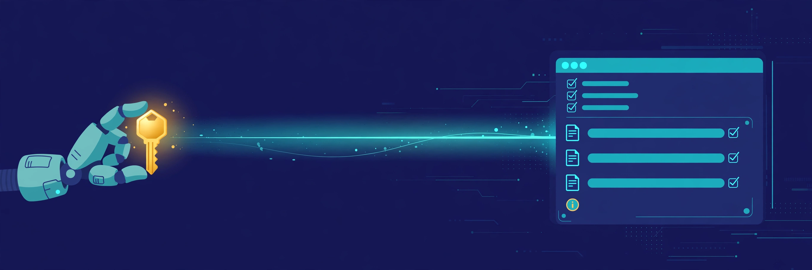

# Agent Token — API Access for AI Agents

English | [简体中文](README.zh-CN.md)




A WordPress plugin that gives your AI agent a single, revocable token for the WordPress REST API — no username and password pairs, no Basic Auth.

[](https://ko-fi.com/aitoken)

## Why not Application Passwords?

Your AI assistant needs to work in WordPress: draft posts, review content, update pages. To do that through the REST API, it needs credentials.

The built-in option, Application Passwords, was designed for humans pasting a username and password pair into an app once. AI agents don't work that way:

- **Agent credential vaults store one secret, not two.** Most agent platforms (including Muse's custom connectors) have a single API-key field. An Application Password is a username *plus* a password — it simply does not fit, and the connection gets refused.
- **Application Passwords rely on Basic Auth.** Many shared and managed hosts strip or block the `Authorization` header, so perfectly valid credentials fail with no useful error.
- **A stored password pair is hard to scope and revoke.** Credentials end up tied to a real user account, and revoking means digging through profile pages. Agent Token stores only a hash, and revocation is one click.

Note: if your tooling can use Application Passwords (local scripts, your own server code), they remain a fine built-in option. Agent Token exists for the growing number of agent platforms that cannot.

## How it works

- Generate a token in **Settings → Agent Token**. It is shown **once**; only its SHA-256 hash is stored.
- Map the token to a dedicated WordPress user you choose (for example, an Editor account created just for your agent). The token can do exactly what that user can do — no more.
- Your agent sends the token in a simple header (`X-Agent-Token`) over HTTPS. No Basic Auth, no username, nothing else to configure.
- Rotate or revoke the token in one click whenever you want — the old token stops working instantly.
- **Copy-paste setup:** when you generate a token, the plugin gives you a ready-made setup snippet. Paste it to your agent and it is connected.

## Security design

- **Hash-only storage:** the token is a 48-character random string (~285 bits of entropy); only its SHA-256 hash is kept in the database, so a database leak does not leak usable tokens.
- **HTTPS only:** tokens are honoured solely on HTTPS requests.
- **Constant-time comparison** via `hash_equals`, so token checks don't leak timing information.
- **Least privilege by mapping:** the token acts as the WordPress user you map it to. Map it to a low-privilege dedicated account to keep the blast radius small. The plugin grants no extra permissions of its own.
- **Nothing works when nothing is configured:** with no active token, no request is authenticated.
- **No telemetry, no external calls.** The plugin never phones home and adds no public write endpoints of its own — it only authenticates standard REST API requests as the mapped user.

## Agent self-discovery (manifest)

The plugin publishes a small public, read-only manifest so a conforming agent can figure out how to connect from just your site address:

```
GET /wp-json/agent-token/v1/manifest
```

It returns non-sensitive connection details only: the site URL, the auth header name, the plugin version, whether a token is configured, and a summary of the mapped account's role/capabilities. It never returns the token, its hash, or any user's email or personal data.

## Installation

1. Download this repository and place the files in a folder named `agent-token` under `/wp-content/plugins/` (or install the plugin from the WordPress.org plugin directory once listed).
2. Activate the plugin.
3. (Recommended) Create a dedicated user for your agent, with the smallest role it needs (Editor is typical), under **Users → Add New**.
4. Go to **Settings → Agent Token**, pick the mapped user, and click **Generate token**.
5. Copy the token and the setup snippet immediately — the token is shown only once — and paste them into your agent's credential vault / connector settings.

Requirements: WordPress 6.0+, PHP 7.4+. Version 1.0 targets single-site installs (multisite is not supported yet).

## FAQ

**Can't my agent just log in with my username and password?**
A saved login serves a browser clicking through wp-admin like a human — it has to pass the full login flow (including two-factor prompts) every session, and it cannot feed anything else. API connectors, cron jobs, and other headless tools never see a browser; what they can store is a single API secret. A token authenticates REST API calls directly, at any hour, with no login ceremony — and unlike your password, it cannot be used to sign in to wp-admin at all. Use saved logins for clicking; use a token for unattended API work.

**Which agents does it work with?**
Any agent or tool that can call the REST API with a custom header: Muse custom connectors, MCP-based tools, local automation scripts, and similar.

**What happens if I deactivate or uninstall the plugin?**
All tokens stop working immediately. Uninstalling removes the plugin's settings from the database.

## Background

Agent Token was written because an AI assistant reviewing drafts on a real site could not use Application Passwords at all. It has run that workflow daily in production since. Built for a real agent workflow, not a demo.

## Support

If this plugin saves you time, you can support its development on Ko-fi: https://ko-fi.com/aitoken

## License

GPLv2 or later. See [LICENSE](LICENSE).
